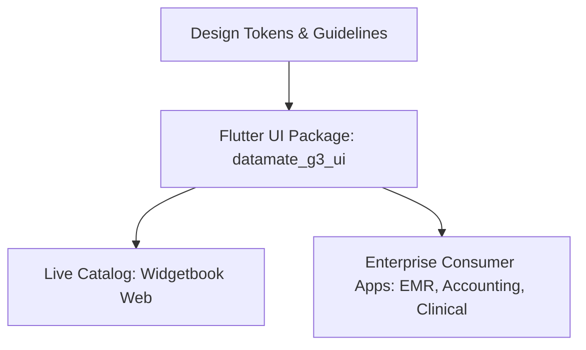

# Datamate G3 Design System: Agent Directives & Architecture

This repository defines the single source of truth for the Datamate G3 UI ecosystem. The system bridges design specifications and production code through three interconnected layers: **Design Guidelines (Tokens)**, **Core Flutter UI Package**, and a **Live Flutter Web Catalog (Widgetbook)**.

---

## 1. Project Architecture Overview



| Layer | Purpose | Primary Artifacts |
| :--- | :--- | :--- |
| **Guidelines (The Blueprint)** | System foundations, token specs, and usage rules | Markdown specs, JSON token scales |
| **Package (`datamate_g3_ui`)** | Reusable, themeable Flutter component library | Dart package, `ThemeExtension`, Widgets |
| **Catalog (Widgetbook)** | Interactive web showcase for developers & designers | Flutter Web app, Widgetbook use-cases |

---

## 2. Layer 1: The Design Guidelines (The Blueprint)

Never rely on arbitrary styling. All UI constructs derive strictly from design tokens.

### A. Foundations (Design Tokens)
- **Spacing & Layout Grid:** Strict 4px/8px baseline grid (`4`, `8`, `12`, `16`, `24`, `32`, `48`, `64`). Arbitrary margins or paddings are prohibited.
- **Typography:** Fixed type scale (Display, H1–H6, Body Large/Medium/Small, Caption, Overline) with defined line heights, font weights, and tracking.
- **Color Palette:** Strictly semantic tokens (`primary`, `secondary`, `surface`, `background`, `success`, `warning`, `error`, `outline`) rather than literal colors (e.g., use `warning-500`, not `yellow-500`). Must support Light and Dark themes natively.

### B. Component Library Spec
- **Core Primitives:** Buttons (filled, outlined, text), TextFields (clinical/numeric/standard), Checkboxes, RadioButtons, Switch, Badges, Tooltips, Modals/Dialogs.
- **Enterprise & Domain Patterns:**
  - Specialized clinical and EMR layouts (e.g., vitals entry, patient header bar).
  - High-density data tables and grids with sorting, filtering, and pagination.
  - Master-detail multi-pane layouts for desktop/tablet screens.
  - Sticky toolbars, collapsible sidebars, and auditing/status indicators.

---

## 3. Layer 2: The Flutter UI Package (`datamate_g3_ui`)

The UI library must be packaged as an isolated, standalone Dart package to ensure portability across the Datamate G3 ecosystem.

### Key Implementation Standards
- **Zero Hardcoded Styles:** All paddings, radii, typography, and colors must be accessed via `BuildContext` or design token constants.
- **ThemeExtensions:** Custom design tokens (such as `AppSpacing`, `AppElevation`, and extended semantic colors) must be injected into Flutter's `ThemeData` via `ThemeExtension<T>`.
  ```dart
  // Example usage in components
  final spacing = Theme.of(context).extension<AppSpacing>()!;
  final colors = Theme.of(context).extension<AppSemanticColors>()!;
  ```
- **Modularity:** Separate tokens, atomic components, and complex compound patterns into distinct directories (`lib/src/tokens/`, `lib/src/components/`, `lib/src/patterns/`).

---

## 4. Layer 3: The Live Web Catalog (Widgetbook)

The living sample application replaces static docs with a runnable Flutter Web application.

### Objectives & Capabilities
- **Component Isolation:** Every core widget and pattern must have an isolated Widgetbook use-case.
- **Interactive Controls (Knobs):** Allow developers to toggle states (disabled, loading, error), switch text lengths, and inspect responsive boundaries.
- **Addons & Environment Controls:**
  - Theme switching (Light vs. Dark mode).
  - Viewport presets (Desktop 1920x1080, Tablet, Surface, Mobile).
  - Text scale factors for accessibility testing.
- **Documentation Parity:** Keep component API docs and token references side-by-side with the live widget render.

---

## 5. Agent Workflow & Execution Strategy

When generating code or documentation in this workspace, follow this phased progression:

1. **Audit & Token Definition:**
   - Formalize Spacing, Color, and Typography token contracts first.
2. **Package Foundation (`datamate_g3_ui`):**
   - Initialize package layout, `ThemeExtension` classes, and base theme builders.
3. **Component Construction:**
   - Implement widgets against tokens with full test coverage and accessibility guarantees.
4. **Widgetbook Stories:**
   - Wire every new component into the Widgetbook catalog with complete knob configurations.
